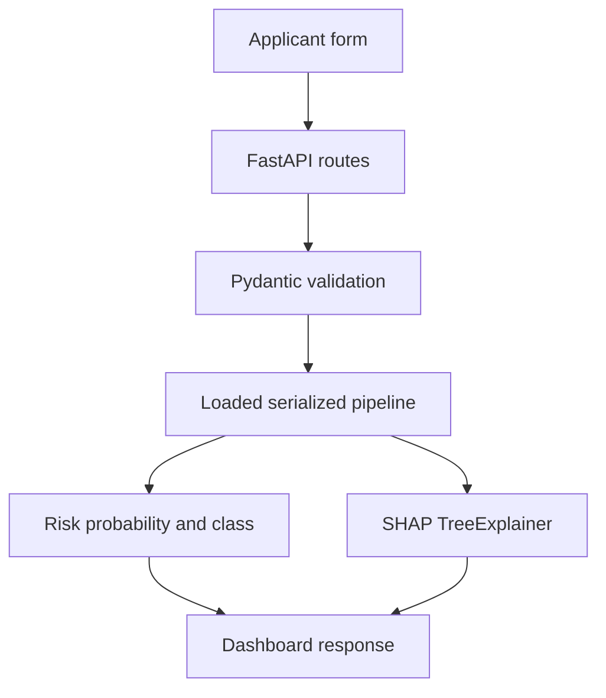

# System Architecture

The project is a frozen-model inference demonstration. The saved pipeline in
`models/final_credit_risk_model.joblib` is loaded once during FastAPI startup;
requests never retrain or modify it.

The API serves the static dashboard from `app/static/`. The browser submits the
same validated applicant payload to prediction and explanation endpoints. The
backend performs feature engineering through the serialized pipeline, applies
the frozen 0.50 evaluation threshold, and returns the result. SHAP values are
reported in raw-margin/log-odds space as model contributions, not causal
effects.

The training workflow is documented in the README and is not executed by the
runtime application. The final artifact uses the all-valid feature scenario,
including loan grade and interest rate; their availability before a real credit
decision still requires domain validation.
